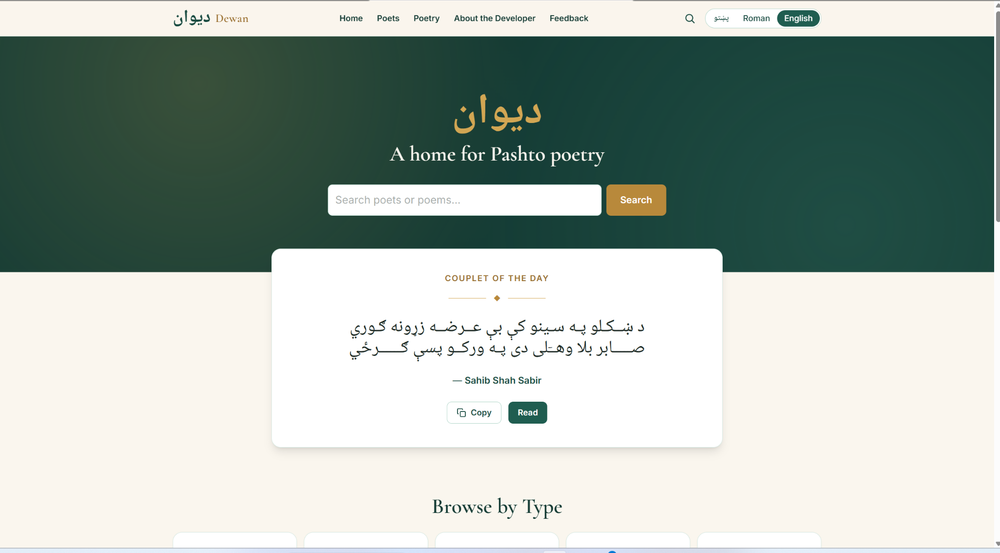
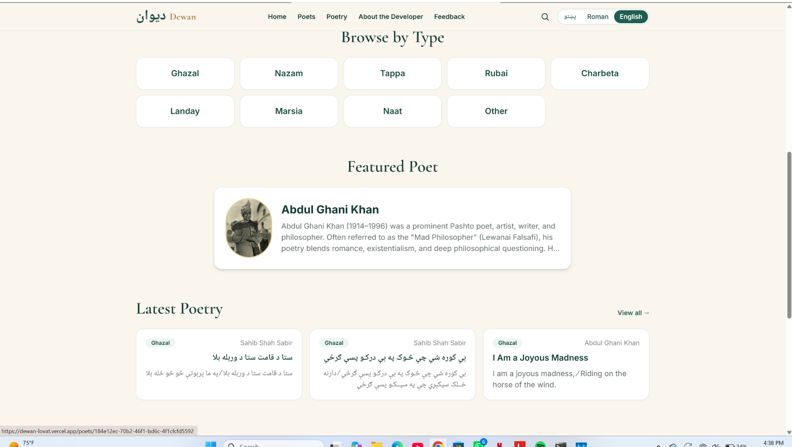
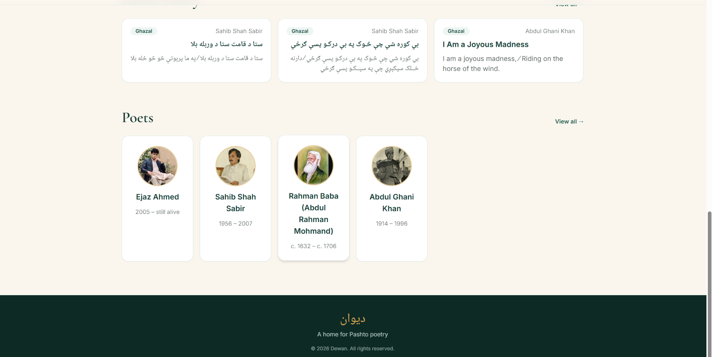
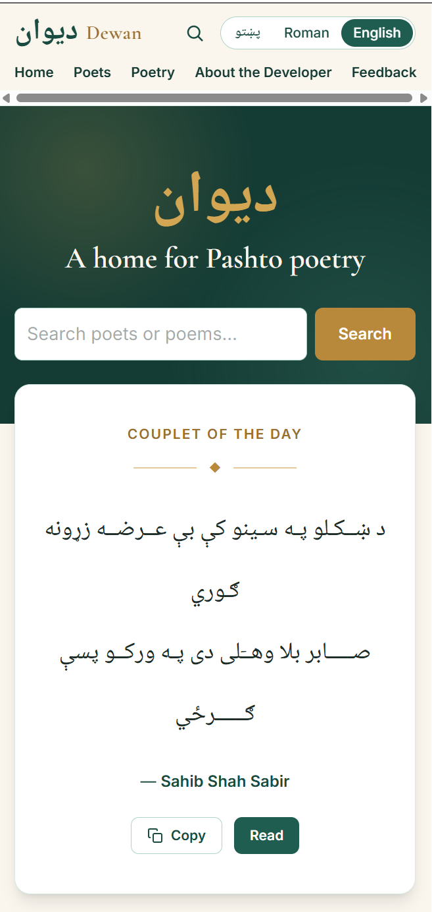
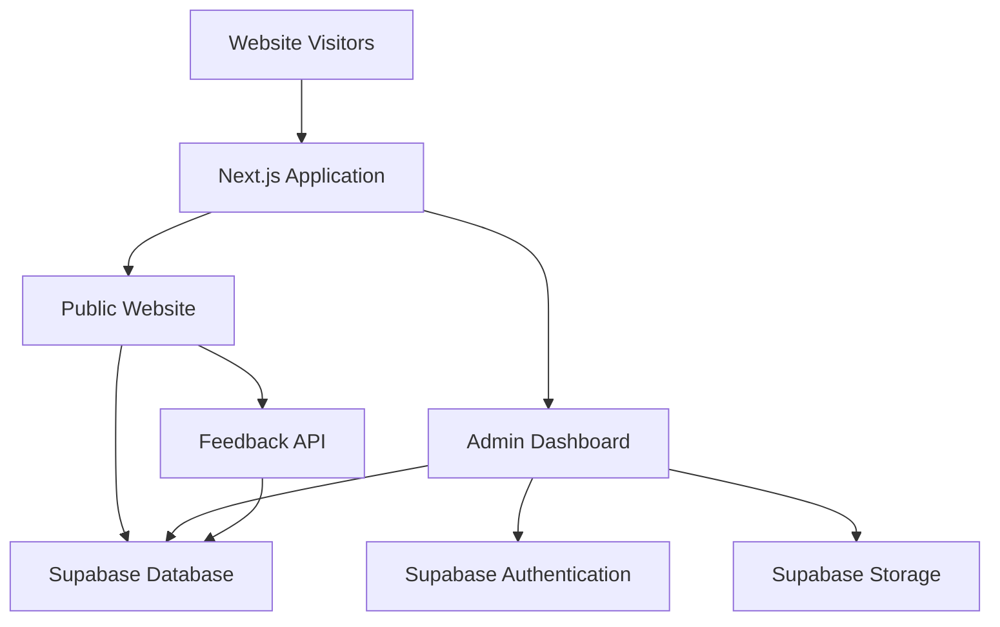

<div align="center">

# Dewan

### A Multilingual Pashto Poetry Platform

A modern web application dedicated to discovering,
reading, and preserving Pashto literature.

<br/>


<br/>

[Explore Website](https://dewan-lovat.vercel.app) |
[Source Code](https://github.com/miksi0078/dewan)

</div>

---

## Project Overview

Dewan is a multilingual literary web application
focused on Pashto poetry and cultural content.

The project combines a modern Next.js interface
with Supabase-backed content management.

### Project Scope

- Poetry and poet collections
- Multilingual content presentation
- Poetry search and browsing
- Audio, video, and PDF media support
- Administrative content management
- User feedback functionality
- Responsive web interface

## Technology Stack

| Layer | Technology |
|---|---|
| Frontend | Next.js, React |
| Language | TypeScript |
| Styling | Tailwind CSS |
| Backend Services | Supabase |
| Database | PostgreSQL via Supabase |
| Deployment | Vercel |

---

## Website Preview

### Desktop Homepage

<p align="center">
  
</p>

### Poetry Browsing

<p align="center">
  
</p>

### Poet Directory

<p align="center">
  
</p>

### Mobile Experience

<p align="center">
  
</p>

---

## System Architecture

Dewan follows a modern full-stack architecture using Next.js and Supabase.



### Architecture Components

| Component | Responsibility |
|---|---|
| Next.js | Application routing and server-side rendering |
| React | Reusable user interface components |
| TypeScript | Type-safe application development |
| Tailwind CSS | Responsive interface styling |
| Supabase Database | Storing poets, poetry, and other records |
| Supabase Authentication | User authentication for administrative access |
| Supabase Storage | Managing uploaded media files |
| Next.js API Routes | Server-side operations such as feedback handling |

---

## Getting Started

### Prerequisites

Before running the project locally, install:

- Node.js 20 or later
- npm
- Git
- Access to a configured Supabase project

### Installation

Clone the repository:

```bash
git clone https://github.com/miksi0078/dewan.git
```

Navigate to the project:

```bash
cd dewan
```

Install the dependencies:

```bash
npm ci
```

### Environment Configuration

Create a `.env.local` file in the project's root directory.

Configure the environment variables:

```dotenv
NEXT_PUBLIC_SUPABASE_URL=https://YOUR_PROJECT.supabase.co
NEXT_PUBLIC_SUPABASE_ANON_KEY=YOUR_PUBLIC_ANON_KEY
SUPABASE_SERVICE_ROLE_KEY=YOUR_PRIVATE_SERVICE_ROLE_KEY
NEXT_PUBLIC_SITE_URL=http://localhost:3000
```

The Supabase database schema is located in
`supabase/schema.sql`.

Apply the schema to your own Supabase project before running the application.

**Security:** Never commit `.env.local`, private API keys, or service-role credentials to GitHub.

### Start Development Server

```bash
npm run dev
```

Open:

http://localhost:3000

### Production Build

```bash
npm run build
```

To start the production server locally:

```bash
npm start
```

---

## Repository Structure

```text
dewan/
├── src/
│   ├── app/
│   │   ├── (site)/
│   │   ├── admin/
│   │   ├── api/
│   │   └── auth/
│   ├── components/
│   ├── lib/
│   └── middleware.ts
├── supabase/
│   ├── schema.sql
│   └── seed_optional.sql
├── package.json
├── tailwind.config.ts
├── tsconfig.json
└── README.md
```

---

## Project Status

Dewan is an academic and personal web development project.

The repository documents the application's implementation and development. Individual deployment features should be tested before production use.

## Developer

**Muhammad Ilyas**

BS Artificial Intelligence  
University of Central Punjab, Lahore

[GitHub Profile](https://github.com/miksi0078)
```

